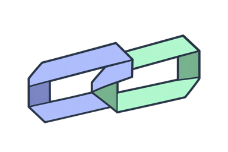

#  PaperChain

PaperChain is a native macOS window manager built from scratch in Swift. It arranges windows in a horizontal strip on each display. Your editor, notes, and browser keep their order as you move between them, and each display keeps its own place.

**[Download PaperChain for macOS](https://github.com/Harshal96/paperchain/releases/latest/download/PaperChain.dmg)** · [Installation guide](../docs/installation.md) · [User guide](../docs/user-guide.md)

Version 0.0.1 runs on Apple silicon and Intel Macs with macOS 14 Sonoma or later.

## Navigating the strip

The monitor shows the windows you can see. The smaller strip shows the entire group in order, including the windows beyond the screen edges. Follow the outline on the strip as a neighboring window slides into focus.

Click the visible part of a neighbor to focus it, or select a window in the PaperChain dock to jump farther along the strip. Turn on **Dim side windows** in **Settings → Appearance** to darken the neighbors when a window is centered between them.

## Organizing your workspace

- **Groups.** Keep a project’s windows together in a named group. Switch projects on your main display while keeping a reference document visible on another. Returning to a group restores its window order and selection.
- **Stacks.** Place two windows in one column to read a document above your notes. On a portrait display, PaperChain pairs windows vertically so two columns can show four windows.
- **Floating windows.** Option-drag a window by its title bar to move it freely. When you want it back in the strip, choose **Attach window** from the dock.

## Installation

Sign in to GitHub with access to the repository and download the disk image. Drag **PaperChain** onto **Applications**, eject the image, and open the installed app. Choose **Grant Accessibility Access…** from its menu bar icon so it can arrange your windows. The [installation guide](../docs/installation.md) covers first-launch prompts and updates.

Repository and build information

## GitHub Actions

On pushes and pull requests, the Linux job runs the checks and window simulator. The macOS job builds and signs the app bundle. [Workflow definition](workflows/check.yml)

Browse the [source architecture](../Sources/README.md), [build and packaging scripts](../scripts/README.md), or [test suites](../Tests/README.md).

[MIT license](../LICENSE)
