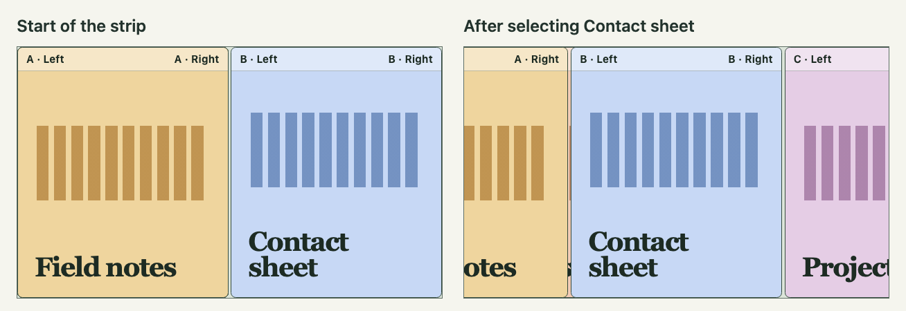

# Paper Chain

Paper Chain is a native macOS window manager built from scratch in Swift. It arranges windows in a horizontal strip on each display. Your editor, notes, and browser keep their order as you move between them, and each display keeps its own place.

**[Download Paper Chain for macOS](https://github.com/Harshal96/paperchain/releases/latest/download/Paper-Chain.dmg)** · [Installation guide](docs/installation.md) · [User guide](docs/user-guide.md)

Version 0.0.1 runs on Apple silicon and Intel Macs with macOS 14 Sonoma or later.

## Navigating the strip

In the illustration below, *Field notes* and *Contact sheet* start side by side. Selecting *Contact sheet* brings it to the center, with *Field notes* still visible on the left and *Project brief* coming into view on the right. Click either neighbor to continue. To jump farther along the strip, open the Paper Chain dock on that display and select a window by its icon.

## Organizing your workspace

- **Groups.** Keep a project’s windows together in a named group. Switch projects on your main display while keeping a reference document visible on another. Returning to a group restores its window order and selection.
- **Stacks.** Place two windows in one column to read a document above your notes. On a portrait display, Paper Chain pairs windows vertically so two columns can show four windows.
- **Floating windows.** Option-drag a window by its title bar to move it freely. When you want it back in the strip, choose **Attach window** from the dock.

## Installation

Sign in to GitHub with access to the repository and download the disk image. Drag **Paper Chain** onto **Applications**, eject the image, and open the installed app. Choose **Grant Accessibility Access…** from its menu bar icon so it can arrange your windows. The [installation guide](docs/installation.md) covers first-launch prompts and updates.

Project documentation

| Area | Documentation |
| --- | --- |
| Application | [Source architecture](Sources/README.md) and [macOS bundle resources](Resources/README.md) |
| Development | [Build and packaging scripts](scripts/README.md) and [tests and simulator](Tests/README.md) |
| Automation | [GitHub Actions](.github/README.md#github-actions) |

[MIT license](LICENSE)
